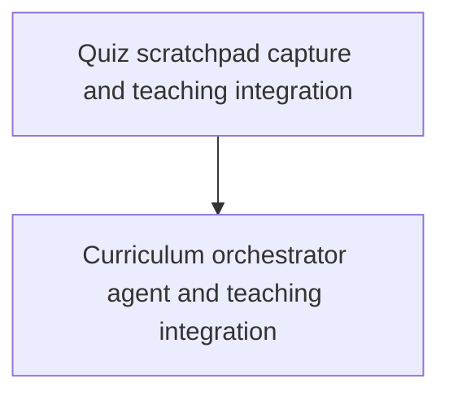

# PI Agent Teacher Improvements — Execution Plan

> [!abstract] Scope
> Implement the two incomplete leaf notes under `PI AGENT TEACHER IMPROVEMENTS` in the Tomato Vault Stashpad. Keep this project tracker separate from curriculum plans created during teaching; curriculum plans belong in the linked md-log.

## Execution order

The scratchpad work comes first because it supplies ongoing learner-reasoning context that the teaching process—and later orchestration—can use. The orchestrator follows once that input path is in place.

## Items

### 1. Quiz scratchpad capture and teaching integration

- **Source note:** `Stashpad/After-User-Answers-Quiz-Question-Probe-Linked-Md-zj3rkv.md`
- **Status:** Done
- **Implementation scope:** Add an editable fenced scratchpad template after each quiz question callout. After an answer, capture only text inside the fenced block associated with the nearest question callout above it in the linked md-log. Preserve captured text when the transcript refreshes and make it available to the main teaching agent as ongoing context for its next question. Missing, empty, or unlinked scratchpad content must not block the quiz flow.
- **Acceptance criteria:**
  1. Each quiz question in the md-log has a blank fenced scratchpad area immediately following its question callout.
  2. Extraction is restricted to fenced scratchpad content and associates content with the nearest preceding quiz question, including in notes with multiple quiz rounds.
  3. Text outside the fenced area is never included as scratchpad; absent or empty fenced content yields normal quiz behavior.
  4. Captured text survives managed-transcript updates and is available to the main agent after the quiz result for adapting subsequent questions.
  5. Focused deterministic tests cover parsing/association, empty and missing content, exclusion of surrounding text, and transcript preservation; relevant existing tests pass.
  6. The teach skill explains how to treat scratchpad text as learner reasoning, not as an answer replacement, and use it to shape the next probe.
- **Verification:** `node --experimental-strip-types --test tests/*.test.mjs` passed (22/22); `node --experimental-strip-types scripts/md-log-smoke.mjs` passed.
- **Completion:** After verification passed, set the source note's `completed` metadata to `true`, then mark this item Done.

### 2. Curriculum orchestrator agent and teaching integration

- **Source note:** `Stashpad/Devise-Agent-Md-Curriculum-Orchestrator-Which-Uses-bmiyiv.md`
- **Status:** Done (depends on item 1)
- **Implementation scope:** Add a dedicated agent definition using model `gemini-4-argon`, plus teaching-skill guidance that invokes it only when a detailed curriculum/dependency map is useful. Require an explicit allow/deny prompt before dispatch; on denial or unavailable interactive UI, keep planning in the main agent. Do not silently substitute a model if `gemini-4-argon` is unavailable; stop and ask the user. Keep web-research delegation conservative, capped at two researcher subagents and using a second only when needed. Return a readable curriculum plan for the main agent to present in the linked md-log, wrapped in distinct invisible markers so later sessions can find it.
- **Acceptance criteria:**
  1. A new agent definition follows existing `.pi/agents` frontmatter and formatting conventions and specifies `gemini-4-argon` without a silent fallback.
  2. The teach skill gates every orchestrator dispatch behind a clear allow/deny prompt before dispatch; decline or unavailable UI leaves planning with the main agent.
  3. Model unavailability stops dispatch and requires the user's decision; no alternate model is selected automatically.
  4. Orchestrator use is limited to detailed plan/map stages, with no more than two researcher subagents and a conservative default of one when research is needed.
  5. The returned curriculum plan is both human-readable and useful to future agents, includes learning sequence/dependencies and execution details, and is presented in a distinct `%%...%%`-marked block that the linked md-log can preserve.
  6. Focused deterministic tests validate agent configuration and the relevant teaching/plan-format conventions; relevant existing tests pass.
- **Verification:** `node --experimental-strip-types --test tests/*.test.mjs` passed (25/25); `node --experimental-strip-types scripts/md-log-smoke.mjs` passed.
- **Completion:** After verification passed, set the source note's `completed` metadata to `true`, then mark this item Done.

## Verification and status policy

Run deterministic focused checks for each item, then the existing test suite where applicable. A failed check keeps the source note incomplete and the plan item In progress or Blocked, with the failure recorded. After a successful check, update the source note minimally and then mark the corresponding item Done.
