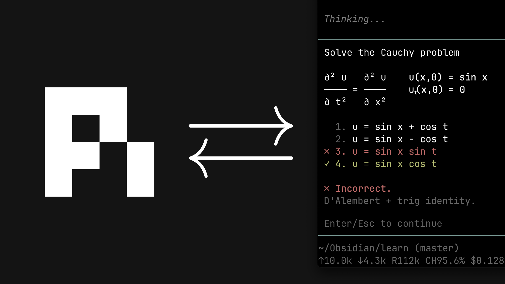

# learn
Fork of [amosblomqvist/learn](https://github.com/amosblomqvist/learn) with Termy support for linking the active Obsidian note through `/md-log` as well as a suite of other personal feature additions slop-coded by GPT 6 Luna over several weeks mostly via VSCopilot. Contact me if you want to run this project on your local computer and run into issues of compatibility, or create a PR if you're a gigachad. The current iteration likely has a multitude of untested issues/bugs.

Currently only compatible with the Termy Obsidian terminal plugin. Future compatibility is not planned.

[](https://www.youtube.com/watch?v=kzcI5F4tGiU)

My AI learning system from this video: [How I Use AI to Learn Things](https://www.youtube.com/watch?v=kzcI5F4tGiU).

This is a personal system I built for myself, shared as-is. Built as a pi configuration: the teaching philosophy encoded in a skill, a few small extensions, and agent definitions.

## What's in it

- `skills/teach/` — the philosophy and the process
- `skills/visualize/` — adds a correct, minimal diagram to a lesson when an idea is clearer as a picture
- `extensions/md-log.ts` — links the active Obsidian note and records the session; authored prose outside the managed section is brought in once, with free-form imported text wrapped in a `Notes` callout.
- `extensions/ask-user-question/` — the agent asks you questions through a UI popup
- `extensions/quiz.ts` — graded questions with 4–8 answer options, automatically randomized order, immediate feedback, and an optional linked-md-log scratchpad. Quiz, free-response, and learning-interview dialogs share the same popup shell; explanations, interview answers, and mastery details are preserved in collapsed-by-default native Obsidian callouts.
- `extensions/teach-learning-tools.ts` — project-local free-response, a multi-step `teach_learning_interview` for clarifying learning goals (never scored as mastery evidence), scored quiz/free-response evidence, bounded round assessments, vault concept search/registration, evidence-backed mastery sync, and preview-gated concept merges. The teaching agent checks relevant mastery context before one short interview in a genuinely new lesson session, and may use a tailored follow-up after a full quiz assessment when the next focus remains unclear. The interview is goal elicitation; purposeful baselines still reuse the existing quiz/free-response assessment forms. Concept candidates are ranked across IDs, canonical names, definitions, aliases, subject paths, and notes, but are suggestions only; search also returns compact recent evidence-journal context. Individual mastery evidence is scored immediately, and an optional concept-level round assessment supplements rather than replaces its source interactions. New evidence is stored as compact events in vault-root `mastery-evidence.json`; scalar Obsidian mastery properties are replayed projections and stale projections are repaired from the journal. Scored assessment details are collapsed by default in the md-log. A `mastery-concepts.json` catalogue holds canonical IDs and subject metadata. Concept merges require replayable evidence, a fresh preview token, and explicit learner approval; legacy aggregate-only records are not mergeable. `teach_*` names avoid collisions with globally installed learning tools.
- `extensions/generator-slots.ts` — one global concurrency limit for every generator subagent (`breeze-tts-maker`, `comfyui-image-maker`, `mermaid-maker`, `svg-maker`). TTS and ComfyUI both saturate the GPU, so a burst of requests used to freeze the machine. Generator dispatches now queue instead of all starting at once; the limit defaults to 2 and is overridable with `PI_GENERATOR_CONCURRENCY` (clamped 1–8). `/generator-slots` reports current usage. A slot is released when the job completes, fails, or is dispatched in the foreground, with a 20-minute backstop.
- `extensions/teach-visual.ts` — the main agent's only diagram tool, and the mermaid/svg counterpart of `teach_comfyui_paint`. It takes a `kind` (`mermaid` or `svg`), a plain-language `brief`, a `captionTitle`, a `caption`, and an exact note anchor; it inserts a `%%pi-visual:<kind>:<id>%%` marker there and dispatches the matching maker in the background. A runtime guard blocks direct `Agent` launches of both makers. The maker publishes its PNG and calls `teach_attach_generated_visual`, which validates the file is inside its own `001-Attachments` folder and replaces the marker with a captioned embed — the same placeholder-then-link contract images and audio use.
- `extensions/teach-comfyui-paint.ts` — the main agent's only ComfyUI tool. It accepts a plain-language `prompt`, a descriptive `captionTitle`, an explanatory `caption`, and an exact note anchor chosen by the main agent; it inserts a `%%pi-comfyui-image:<id>%%` marker there and dispatches the image-maker through the global `Agent` tool in the background. A runtime guard blocks direct `Agent` launches of the image-maker so they cannot bypass marker setup.
- `extensions/cover-image.ts` and `/cover-image` — create a concrete, note-specific, brush-painted 3:2 cover for the linked md-log note or a directly referenced Markdown note (for example, `/cover-image @100-Learning/topic.md`). The command uses 4-step MOSS at 1088×720 with no upscaling, saves under `001-Attachments/~covers`, and writes both an Obsidian `cover: "[[...]]"` link and a concise `overview` property of exactly 56–64 Unicode characters. It keeps generated covers tied to an unchanged note snapshot, applies a stable folder-specific border color and brush style, and suppresses text boxes that cannot fit at a legible size; CJK glyphs receive wider capacity estimates than Latin characters.
- `agents/extensions/comfyui-image.ts` and `agents/extensions/teach-image-attachment.ts` — isolated to the `comfyui-image-maker` subagent. It refines the prompt into a fixed MOSS API call, then duplicates the descriptively named output into `001-Attachments/~comfyui` (creating the folders when absent) and replaces the exact note marker with a titled quote callout containing the italicized, quoted caption, followed by a standard Obsidian embed such as `![[001-Attachments/~comfyui/image.png]]`.
- `extensions/teach-breeze-tts.ts` and `agents/extensions/breeze-tts.ts` — the main agent owns Breeze TTS markers, retries, WAV validation, attachment placement, and note replacement. Narration can be generated synchronously from a main-authored exact script, or asynchronously by the isolated subagent using an exact or explicitly interpretive script policy; both routes preserve the exact spoken transcript. The teacher anchors narration to exact logged concept text; the linked note's `breeze-voice-preset` frontmatter property selects either standard Breeze voice design or a random matching six-digit WAV and `{id}-transcript.txt` clone pair. Audio is placed under `001-Attachments/~breezetts` with a unique filename containing the clone name (when used) and an exactly five-word narration description; a collapsed quote callout containing the spoken transcript is placed below the embed.
- `scripts/breeze_voice_presets.py` — a standalone Tkinter editor for the local, ignored `breeze-voices.json` manifest. Add, edit, remove, and validate named WAV/transcript folder pairs. Before the first Breeze request for a linked note without a valid `breeze-voice-preset` property, the user selects a clone preset or the built-in standard non-clone voice. The selected preset's human-readable `name` is stored in that note's frontmatter and resolved back to the matching configured preset on later sessions; the built-in choice is stored as `Standard Breeze voice`. Use the preset's **Build / edit…** button to create `style-instructions.json` from quick voice, delivery, pace, emotion, and pronunciation fields; the file is loaded into that preset and supplied as voice-delivery guidance.
- `scripts/configure_paths.py` and `/configure-paths` — open the Tkinter local-path settings UI for the audio.cpp and optional CUDA root folders, the default Breeze clone folders, and the md-log demo output. Machine-specific settings are stored in the ignored `local-paths.json`; use the clickable [Windows configuration shortcut](scripts/configure-paths.cmd) or run `/configure-paths` in Pi.
- `agents/breeze-tts-maker.md` — generates a staged WAV from an exact main-authored script or an authorized expressive reinterpretation; it does not edit notes or place attachments.
- `extensions/csv_tools.ts` — read-only, workspace-contained CSV inspection, field filtering, sorting, aggregation, and bounded text search for the main agent and researcher. The researcher also uses explicitly scoped Pi web and YouTube tools plus the locally authored bounded `read_json_data` tool; neither researcher nor curriculum planner has Bash access. It parses and searches locally, with 10 MiB / 100,000-record input limits and at most 20 returned rows. Comma-, tab-, and semicolon-delimited files are supported; omitted trailing fields are treated as empty. Search supports Chinese, Japanese, and Korean text using character and overlapping-pair tokens. The interactive terminal renderer shows every returned field under its original header, bounded by display limits, with Pi's standard `Ctrl+O` expand/collapse behavior.
- `extensions/visual-tools/` — tools for visualization subagents
- `agents/` — `researcher`, `svg-maker`, `mermaid-maker`, `comfyui-image-maker`, `breeze-tts-maker`, three provider-specific `mastery-critic` profiles, and the consent-gated `curriculum-orchestrator`. The teacher may use a low-cost critic from a different provider when an answer is complex or ambiguous; straightforward answers are graded without one. External research is consent-gated, with a limit of one active researcher per calling agent (including the main teacher and curriculum orchestrator); the orchestrator may delegate only when explicit research consent is included in its brief. The main teacher asks permission before dispatching the orchestrator and saves the returned marked plan in the linked md-log. Specialist agents have explicit tool/extension scopes; critics receive no tools, extensions, skills, or inherited conversation. The ComfyUI subagent has only fixed-workflow generation/status tools and a purpose-built vault-attachment tool; it has no general file-reading or image-reading tools. The researcher uses Pi web search/source/fetch tools rather than shell-based HTTP requests.

## Install

This repo **is** a `.pi` directory. From your learning project's root:

```bash
git clone https://github.com/amosblomqvist/learn .pi
```

Then open pi in that directory. (Or copy the pieces you want into your existing project config.)

## Requirements

- [pi](https://github.com/earendil-works/pi)
- [tintinweb/pi-subagents](https://github.com/tintinweb/pi-subagents), installed globally with `pi install npm:@tintinweb/pi-subagents`. It loads custom agent definitions from `.pi/agents/` and provides the `Agent` tool. The teaching and visualization skills invoke custom agent types through the project wrappers. Subagents use explicit `extensions:` and `ext:` tool selectors; Bash is removed from the main session's project defaults and denied to all custom agents. See [TOOL-ACCESS.md](TOOL-ACCESS.md) for the policy and capability map.
- `ask-user-question` — use the copy bundled here. If your setup already has an `ask-user-question` extension, use **this** one in its place. Popups from different extensions serialize through a shared UI lock, which only works when it's the same implementation.
- `pi-comfyui-paint@0.3.0` must be available locally to the isolated image-maker extension. Do **not** register it in `.pi/settings.json` as a project-wide package: that would expose its workflow-discovery and unrestricted `paint_*` tools to the main agent. Pi settings and agent-runner preferences are local machine configuration and are not tracked here.

The approved MOSS API-format workflow is `.pi/comfyui_workflows/MOSS_Image_4Step_SeedVR2_API.json`. The general image tool defaults to the 4-step MOSS SFT LoRA, supports the 8-step LoRA when requested, and applies 2× SeedVR2; `/cover-image` derives a validated temporary graph that bypasses SeedVR2 and saves at 1088×720. Prompts, aspect ratios, and optional normalized layout boxes (up to 64) are supplied per request; the general image tool's base image is 0.8–1.2 megapixels before upscaling. Before queueing, the tool checks the selected ComfyUI backend for the workflow's required node classes, model files, and selected speed LoRA, then reports any missing prerequisites directly. General image generation requires ComfyUI 0.42.0 or newer, AusBoss nodes 2.16.1 or newer, and the MOSS, speed-LoRA, and SeedVR2 model files listed in the workflow. The ignored `.pi/comfyui-paint.json` is local configuration: it pins the ComfyUI endpoint and sets `inlineImageLimit` to `0`; do not override this setting because image bytes must not enter an agent context.

The Breeze TTS command wrapper is `scripts/breeze-tts.cmd` and reads its audio.cpp and optional CUDA locations from the ignored `local-paths.json`. It accepts `clon` for reference-voice cloning and `tts` for the standard non-clone voice design path. Configure local paths with `/configure-paths`; use `python scripts\breeze_voice_presets.py` to add or edit additional named voice presets in the ignored `breeze-voices.json`. Each clone preset uses six-digit WAV IDs paired with exact `<id>-transcript.txt` filenames.

## Notes

You can run the system without subagents. The main session does the teaching. You just lose the researcher (truth verification) and the generated visuals.

The teaching skill is written for one learner (me). Edit the skill to fit how you learn best.

In Pi, invoke these skills explicitly with `/skill:teach` or `/skill:visualize`. Enable skill commands in your local Pi settings so they appear in slash-command discovery.

At session start, md-log reports whether the session is linked and to which note. If no note is linked, it checks Termy's active Obsidian file; an empty Markdown note or one containing both md-log transcript markers triggers a Yes/No/Other prompt. Other lets you choose a different existing Markdown note. Declining keeps that session unlinked and shows the active note in the status reminder. An explicit prior `/md-unlog` suppresses the prompt when resuming that session; `/new` and `/fork` check afresh.

Linking an md-log note injects its prior transcript into conversation context. After restarting Pi into a saved session, use `/resume-agent` to continue only explicitly unfinished work; the agent should use the injected transcript and session history rather than shell-searching or rereading the note. Mastery search and merge-preview tools keep structured data for the agent while rendering concise summaries in the terminal.

Use `/rename` to have the agent compare the linked lesson transcript with Markdown filenames across the vault, then rename only the linked log to a descriptive, convention-matching name.

When `/md-log` links a note, it scans the current vault for exact matching mastery concept IDs, adds reciprocal `related` wikilinks, and sends a compact concept-ID preview plus mastery records from matching notes as agent context. Use `teach_find_mastery_concepts` to see ranked suggestions from IDs, canonical names, definitions, aliases, subject paths, and note paths alongside the exact-ID records. Suggestions never trigger an automatic match: verify the learning goal and scope before reusing an ID. Register new concepts—or existing uncatalogued IDs—with `teach_register_mastery_concept`; entries include a canonical name, broad-to-specific subject path, definition, true aliases, and optional parent ID. The catalogue is created lazily in the vault root.

Scored interaction evidence and purposeful round assessments are recorded in vault-root `mastery-evidence.json` as unique, compact events and replayed deterministically. Events store scores, confidence, bounded weight, descriptive outcome, exact interaction IDs, and timestamps; round events also retain source IDs, coverage, and rationale. Raw answers are not duplicated in the journal. Per-note mastery frontmatter is a projection of this event history, and stale projections are repaired whenever journal events are present. On first new evidence for a legacy concept, the previous aggregate is preserved as an opaque baseline; it cannot be merged with other concepts because its original samples are unavailable. To consolidate two registered concepts, first establish that their goals are equivalent, call `teach_preview_mastery_merge`, present the affected notes, evidence counts, resulting record, and any blockers, then ask for explicit approval. Only after approval call `teach_merge_mastery_concepts` with the exact preview token. A stale preview, conflicting duplicate interaction, or legacy baseline blocks the merge without rewriting notes. The old concept ID remains in the catalogue as a redirect and its source name/aliases become aliases of the canonical entry.

## Transcript output and checks

Use `/md-section-start [prefix:] <3-6 word summary title>` and `/md-section-end` to group a teaching section under an H1; the default prefix is `Teaching`. Existing `/quiz-start [title]` and `/quiz-end` commands still group quiz rounds and surrounding conversation. Quiz and question tools can provide `summaryTitle` values to add concise labels to their H2 headings. Each quiz question gets a fenced scratchpad block in the linked note; the optional note field in the quiz UI appends to any existing text there, and the combined reasoning is returned with the quiz result to inform the next teaching question. `teach_free_response` records the learner's response under a question-specific 3–5 word H2. `teach_record_attempt` records outcome, 0–10 evidence score, inferred confidence, bounded weight, and concept mastery; its assessment details are collapsed by default in the md-log and can be omitted explicitly. Mastery is stored as individual scalar Obsidian properties (for example, `mastery__bird-digestive-tract-order__evidence-count`) rather than a nested object, so the Properties view can display each value. Scores are available from the first evidence event and use a 0–10 weighted average; confidence lightly adjusts the default interaction weight. All unrelated frontmatter and authored note content are preserved. After a quiz is answered, the correct option is marked `==🟢...==`; an incorrectly selected option is marked `~~==🔴...==~~`. Other tutoring emphasis follows the semantic color guide in `skills/teach/SKILL.md` and uses Obsidian 1.14+ highlight syntax.

Generated md-log headings use normalized Title Case with spaces in place of hyphens and underscores; authored headings are left unchanged.
Standalone assistant acknowledgments and common image/job progress updates are omitted from the managed transcript; explanatory lesson content continues to be recorded.
Quiz and question dialogs can be paused with F6 without losing selections or typed answers. Run `/answer-resume` after your interlude command to restore the dialog. If you also want Pi Interlude to stash the main editor draft, press F6 again after pausing the dialog; for slash commands that don't auto-restore the stash, press F6 again to restore the editor draft before entering `/answer-resume`. Commands that end or replace the session (such as `/quit`) cannot resume the pending dialog.

The quiz and question dialogs are bottom-anchored overlays so terminal output remains above them. Use `/end-lesson` to have the agent stop teaching and save a hidden resume-state comment at the end of the linked md-log note. The teach skill and md-log use the latest `pi-end-lesson` marker to resume from that point, including an unanswered quiz or question.

SVG maker renders are published under `001-Attachments/~svg`; Mermaid maker images under `001-Attachments/~mermaid`; and ComfyUI images under `001-Attachments/~comfyui`.

Linking pulls the managed section above any prose that precedes it, so authored paragraphs above the markers become addressable anchors and render once inside the section instead of twice. Embeds and transcript callouts already in the note are dropped from the import when a placement re-emits them, so re-linking does not duplicate media. Every inserted transcript callout is followed by a blank line, otherwise the next block would continue its blockquote.

Placement inside the managed section is owned by the renderer alone. The `teach_breeze_tts`, `teach_comfyui_paint`, and `teach_visual` tools record a placement entry and drop a marker into the note only as an immediate visual cue; every sync re-renders the section from the transcript, so the renderer's position always wins. An anchor resolves to the first transcript block containing it, which makes prose the user wrote above the managed markers addressable too — that prose is imported once on link and split into paragraph blocks. Session position is the fallback when an anchor has since disappeared, and an unresolvable placement is appended rather than dropped.

To migrate existing notes from the older nested `mastery:` map, first preview a file or vault directory:

```bash
node --experimental-strip-types scripts/migrate-mastery-frontmatter.mjs "C:\path\to\vault"
```

Add `--write` to apply the conversion. The script processes Markdown files recursively, skips Obsidian and common tooling directories, preserves other frontmatter and note content, and reports malformed notes without overwriting them.

Run the portable formatter/backfill checks and smoke test with Node.js 24 or newer:

```bash
node --experimental-strip-types --test tests/*.test.mjs
node --experimental-strip-types scripts/md-log-smoke.mjs
```

To write or refresh a representative note in the configured vault's `002-Testing` folder:

```bash
node --experimental-strip-types scripts/md-log-demo.mjs
```

Use `--output <path>` to choose another demo file. The script only updates its `pi-md-log` marked section, preserving other content.
